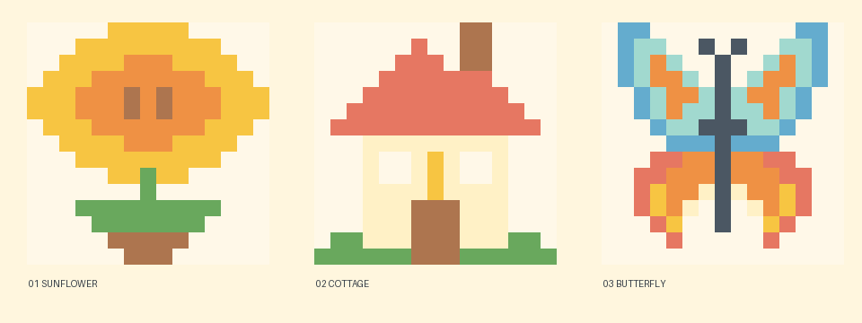

# 像素拾光 · Pixel Moments

**Unity 2022.3.62f3c1（中国版）** 数织解谜游戏。手机 **9:16 竖屏**，内部设计分辨率 900×1600；暖纸底色搭配鲜明的黄、橙、绿、蓝，平面像素画与轻微纸张颗粒，避免塑料高光。

## 打开与试玩

1. Unity Hub 添加仓库，用 **2022.3.62f3c1** 打开，等待 UGUI 与 Test Framework 解析完成。
2. 打开 `Assets/Scenes/PixelMoments.unity`；编辑器会自动将整个 Game 视图的渲染分辨率设为 **900×1600（9:16）**，点击 Play。也可用菜单 `Pixel Moments > Set entire Game View to 9 x 16` 恢复此设置。
3. 从主页选择关卡。选择「涂色」「叉号」或「擦除」后，点击或按住并横向／纵向滑动。
4. 起点格立即标记，首次跨格移动锁定一行或一列；快速滑动会补齐中间格，回划同一格不重复提交。松手后可以另起一笔。
5. 全部 225 格都正确才通关，图像从上到下显色。前两关点「下一关」，第三关点「返回主页」。完成画面保留到点击按钮，不自动跳走。

整个游戏输出采用 9:16 竖屏：主页、选关、棋盘、帮助和通关均共用全屏 Canvas，桌面播放器启动时设置整个窗口为 900×1600。手机锁定竖屏，背景铺满屏幕，UI 根节点伸展至安全区，不再将固定比例的可玩模块缩放嵌入横屏画布。支持单指触屏和鼠标左键拖动，多指不会同时画多笔。

## 三幅完整画作

| 关卡 | 难度 | 内容 | 行线索初始可确定格数 | 行列分段总数 |
| --- | --- | --- | --- | --- |
| 向阳花开 | 入门 | 金黄花盘、种子、绿叶与花盆 | 75 | 38 |
| 晴日小屋 | 进阶 | 珊瑚屋顶、烟囱、留白窗格、木门与草地 | 59 | 44 |
| 花间来信 | 挑战 | 蓝绿上翅、橙黄下翅、对称斑纹与触角 | 31 | 60 |

三个关卡均为 **15×15、唯一解**，能通过行列约束传播解出；难度梯度来自更少的初始确定格和更多分段，需要更多交叉推理。难度标签是设计梯度，仍需真人试玩校准。



## 规则

每关 5 点推理值。错误填色或叉号扣 1 点；正确标记、擦除、重复提交同一状态不扣分。降至 0 后棋盘锁定，重置会清除全部标记并恢复 5 点。滑动并非免费试错：每个新格的错误提交仍各扣 1 点，归零立即停止。

完成状态不可再改图或重置。返回主页后可以重新选择任意关卡。主页收集勾选仅记录本次应用运行，退出不保存棋盘进度。

## 构建

- Android：通过 Hub 安装 **Android Build Support / SDK / NDK / OpenJDK**。菜单 `Pixel Moments > Build Android APK`，生成 `Builds/Android/PixelMoments.apk`（ARM64 / IL2CPP，最低 Android 6.0）。
- Windows：安装 Windows Build Support，菜单 `Pixel Moments > Build Windows Demo`，生成 `Builds/Windows/PixelMoments.exe`，同样为竖屏窗口。
- 命令行（指定编辑器已经安装且激活时）：

```sh
"$UNITY_EDITOR" -batchmode -nographics -quit -projectPath "$PWD" -executeMethod PixelMoments.Editor.ProjectSetup.BuildAndroid -logFile Builds-unity.log
```

**当前云环境没有 Unity 编辑器和许可证，没有生成或验收 APK / EXE。**

## 测试与结构

Unity：`Window > General > Test Runner > EditMode > Run All`。

独立规则测试（.NET SDK 8）：

```sh
dotnet test Tools/CoreTests/CoreTests.csproj
```

本次独立测试 **22 项通过，0 失败，0 跳过**；覆盖唯一解、难度指标、225 格通关、错误锁定重置、滑动补格与去重、三关流程。详情及手机验收步骤见 [Validation.md](Documentation/Validation.md)。

- `Level.cs`：三幅彩色像素画和关卡配置，自动生成线索。
- `Puzzle.cs`：逐格规则与主页／三关流程。
- `LineStroke.cs`：与 Unity 解耦的行列锁定、补格和去重。
- `NonogramSolver.cs`：题目候选生成、约束传播与唯一解验证。
- `BoardInput.cs`：单指／鼠标手势采集。
- `GameView.cs`：竖屏主页、棋盘、工具、揭图与通关导航。

中文字体为 Noto Sans SC（SIL OFL，许可证和来源随项目提供）；音效为程序合成，无背景音乐。源码直接提交 GitHub，不提交 Library、缓存、构建产物或密钥。
